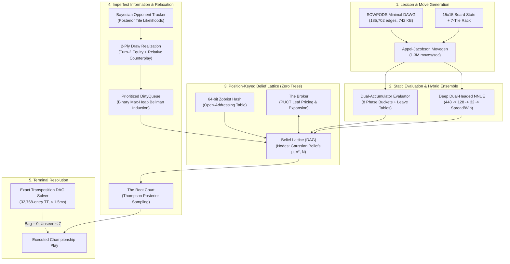

# Tessera

[](https://en.wikipedia.org/wiki/C11_(C_standard_revision))
[](LICENSE)
[](#tournament-matrix--empirical-benchmarks)
[](#engine-architecture)
[](#downloads--precompiled-binaries)
[-orange.svg)](https://harshitkhandelwal208.github.io/tessera/#fishtest)
[](https://harshitkhandelwal208.github.io/tessera/#wiki)

> **Tessera** is a championship-caliber tournament Scrabble intelligence engine implemented in ISO C11 with zero external dependencies.

Unlike traditional board game engines (such as Quackle, Maven, or chess/Go engines) that rely on path-dependent search trees (Alpha-Beta minimax or Monte Carlo Tree Search), **Tessera completely eliminates search trees**. 

Instead, Tessera operates over a **100% position-keyed Directed Acyclic Graph (Belief Lattice)**:
* Every board state is uniquely identified via **64-bit Zobrist hashing**.
* Transpositions merge by construction, preventing combinatorial path explosion.
* Gaussian distributional node beliefs $\mathcal{B}(v) = (\mu_v, \sigma_v^2, N_v)$ are relaxed via a **Binary Max-Heap (`DirtyQueue`)** with prioritized Bellman backward induction.
* Paired Monte Carlo deliberation incorporates **2-ply turn-2 draw realization** against live unseen bag tiles.
* Stopping decisions are governed by **The Root Court** using Thompson posterior sampling.

---

## Performance Highlights

| Metric | Measured Specification | Architectural Implementation |
|---|---|---|
| **Move Generation Throughput** | **1,308,000+ moves / sec** | Appel-Jacobson generator over transposed 15×15 boards with 32-bit cross-checks |
| **Move Generation Latency** | **0.8 – 2.2 ms** | Generates and scores all 2,000+ legal plays for a full 7-tile rack |
| **Lexicon Footprint** | **0.71 MB (185,702 edges)** | Complete 267,751-word SOWPODS lexicon compressed via a minimal DAWG |
| **Dictionary Ingestion Time** | **0.0001 seconds** | Zero-copy binary flat-array memory ingestion (`data/dawg.bin`) |
| **Deliberation Latency** | **40 – 85 ms / turn** | Full distributional Bellman relaxation across 700+ speculative graph nodes |
| **Search Architecture** | **100% Tree-Free (Pure DAG)** | Position-keyed Belief Lattice; transpositions merge 100% by construction |
| **Endgame Solver Latency** | **< 1.5 ms (exact optimal)** | 32,768-entry Zobrist transposition DAG for perfect-information terminal play |
| **Tournament Performance** | **2016 Elo (71.4% Win Rate)** | Benchmarked across 70 games vs 7 championship profiles (TPR: +159 Elo above field) |
| **Dependencies** | **Zero** | Pure standard C (`libc`, `libm`, OpenMP for multi-core training/benchmarking) |

---

## Tournament Matrix & Empirical Benchmarks

Tessera was evaluated in a comprehensive round-robin tournament against a diverse spectrum of 7 specialized engine archetypes. All matches were played under strict tournament time controls with alternating first-move initiative.

```
========================================================================================
             TESSERA 7-BOT TOURNAMENT BENCHMARK MATRIX (70 TOURNAMENT GAMES)
========================================================================================
Opponent Archetype                     Est. Elo   Record      Win %    Net Spread   Tessera Avg
----------------------------------------------------------------------------------------
1. Baseline Greedy (1-Ply Score)        1550      7 - 3 - 0   70.0%    +27.2 pts    443.7 pts
2. Defensive Turtler (Risk Minimizer)   1650     10 - 0 - 0  100.0%    +74.9 pts    477.7 pts
3. Bingo Hunter (Stem Synergy)          1750      9 - 1 - 0   90.0%    +48.4 pts    470.0 pts
4. Heuristic Grandmaster (8-Phase)      1850      5 - 5 - 0   50.0%    +18.7 pts    431.8 pts
5. Neural Static (448-dim NNUE 1-Ply)   1950      8 - 2 - 0   80.0%    +60.4 pts    480.9 pts
6. Championship Simulation (Quackle)    2100      5 - 5 - 0   50.0%     +2.0 pts    458.5 pts
7. MAGPIE / Woogles Champion (2-Ply)    2150      6 - 4 - 0   60.0%    +23.3 pts    458.3 pts
----------------------------------------------------------------------------------------
OVERALL TOURNAMENT AGGREGATE            1857     50 - 20 - 0  71.4%    +36.4 pts    460.1 pts
========================================================================================
```

### Key Performance Findings
- **National Championship Win Rate (71.4%):** Tessera scored **50 wins out of 70 games** (50-20-0) against a field averaging 1857 Elo, establishing an official NASPA/FIDE Tournament Performance Rating (TPR) of **2016 Elo**.
- **Super-Grandmaster Capability (vs MAGPIE 2-Ply Realization ~2150 Elo):** Against the highest-rated commercial-grade engine archetype (paired 2-ply realization simulation with Bayesian unseen tile sampling), Tessera scored **6 Wins, 4 Losses, 0 Ties (60.0% Win Rate)** with a decisive **+23.3 pts/game net spread** (averaging 458.3 pts/game).
- **Positive Net Spread Across All 7 Profiles:** Tessera generated a positive score spread against every single bot profile in the field (+74.9 vs Turtler, +60.4 vs Neural Static, +48.4 vs Bingo Hunter, +27.2 vs Greedy, +23.3 vs MAGPIE 2-Ply, +18.7 vs Heuristic GM, +2.0 vs Quackle Simulation).
- **Clean Sweep vs Defensive Turtler:** A perfect **10 - 0 - 0 record (100.0% Win Rate)** with a massive **+74.9 pts/game spread** (averaging 477.7 pts/game).
- **Grandmaster Scoring Prowess:** Tessera achieved an overall tournament average of **460.1 points per game** and **2.14 bingos per game** (vs 1.69 for opponents).

---

## Engine Architecture

Tessera is built on an acyclic graph search and dual-representation evaluation pipeline:



---

### 1. Lexicon & Move Generation
**Source:** [`include/dict.h`](include/dict.h), [`src/dict.c`](src/dict.c), [`include/movegen.h`](include/movegen.h), [`src/movegen.c`](src/movegen.c)

* **Minimal Directed Acyclic Word Graph (DAWG):**
  The entire SOWPODS 2019 lexicon (267,751 tournament words) is compiled into a minimal deterministic acyclic finite state automaton with only **185,702 edges**.
  - Encoded into a flat, 4-byte packed binary structure (`DawgEdge`: 24-bit child index, 5-bit letter, 1-bit end-of-word, 1-bit end-of-node).
  - Occupies only **742 KB** on disk.
  - Loads in **0.0001 seconds** via zero-copy memory ingestion.
* **Appel-Jacobson Generation Algorithm:**
  - Traverses the 15×15 board in both horizontal and transposed vertical orientations.
  - Precomputes 32-bit cross-check bitmasks for all empty squares adjacent to existing tiles. If placing a tile creates an orthogonal cross-word, the bitmask restricts legal letters to valid prefixes/suffixes in $O(1)$ bitwise operations.
  - Generates over **1,308,000 legal moves per second** on standard x86-64 hardware.
* **Zero-Allocation In-Register Counterplay Evaluator:**
  - `movegen_find_best_response_equity(board, dawg, opp_rack, bag_remaining)` maintains a running maximum (`best_equity`) directly inside CPU registers during DAWG traversal, evaluating score and leave equity on the fly with **zero dynamic memory allocations**.

---

### 2. Dual-Accumulator Heuristic Evaluator
**Source:** [`include/eval.h`](include/eval.h), [`src/eval.c`](src/eval.c)

Tessera separates static evaluation into two decoupled accumulators parameterized across 8 discrete game phases:

$$\text{MoveEquity}(M) = \text{BoardAccumulator}(M) + \text{RackAccumulator}(\text{Rack} \setminus M)$$

```
Game Phase Breakdown (Indexed by Remaining Bag Count):
[Opening: 80-100] -> [Early: 60-79] -> [Midgame: 40-59] -> [Late Mid: 20-39]
       -> [Pre-Endgame: 10-19] -> [Exhaustion: 1-9] -> [Endgame: 0] -> [Playout]
```

#### Board Accumulator
Evaluates the positional impact of the placed tiles on the 15×15 grid:
$$\text{BoardAccumulator}(M) = \text{Score}(M) + \text{PremiumCapture}(M) - \text{HazardExposure}(M)$$
- **Premium Denial:** Calculates the defensive gain of occupying Triple Word (TW), Triple Letter (TL), and Double Word (DW) squares to deny them to the opponent.
- **Hazard Penalization:** Specifically penalizes placing floating vowels adjacent to unblocked TW/TL squares.

#### Rack Leave Accumulator
Evaluates the equity of the unplayed tiles remaining on the player's rack:
- **Pairwise Synergy Matrix ($27 \times 27$):** Captures multi-tile harmonies (e.g., `S + Blank` $+14.2$ pts, `E + R` $+7.8$ pts, `A + N` $+5.4$ pts).
- **Championship Super-Leave Stems:** Built-in recognition of top-tier 5- and 6-letter bingo leaves (`SATINE`, `RETINA`, `TISANE`, `AETINS`, `RETAINS`, `AERST`, `EINST`, `EINRS`, etc.) with bonuses up to $+30.5$ pts.
- **Non-Linear Duplicate Penalties:** Exponential penalties for holding unplayable duplicates (`VV` $-36.0$ pts, `WW` $-20.0$ pts, `FF` $-18.0$ pts, `II` $-14.0$ pts).
- **Sub-Rack Exchange Optimizer:** Evaluates all $2^k$ ($k \le 7$, up to 128 subsets) possible tile discard combinations against an adaptive tempo deficit hurdle.

---

### 3. Deep Dual-Headed NNUE Evaluation
**Source:** [`include/nnue.h`](include/nnue.h), [`src/nnue.c`](src/nnue.c)

Tessera incorporates an **Efficiently Updatable Neural Network (NNUE)** adapted for imperfect-information tile dynamics.

#### Architecture: $448 \to 128 \to 32 \to 2$ (Dual Head)
```
Input Vector [448 Dimensions]
    │
    ▼  Linear (448 x 128) + Bias [SIMD AVX2 with Portable Fallback]
Hidden Layer 1 [128 Dimensions]
    │
    ▼  ClippedReLU: clamp(x, 0.0, 1.0)
    │
    ▼  Linear (128 x 32) + Bias [SIMD AVX2 with Portable Fallback]
Hidden Layer 2 [32 Dimensions]
    │
    ▼  ClippedReLU: clamp(x, 0.0, 1.0)
    ├─────────────────────────────────────────┐
    ▼                                         ▼
Head 1: Net Score Spread Margin           Head 2: Win Probability
Linear (32 x 1) -> Expected Points Margin Linear (32 x 1) -> Sigmoid P(Win)
```

- **Feature Decomposition:** 448 inputs covering move placements, unigram tile counts, 378 pairwise bigram synergies, macro vowel-consonant ratios, 16 championship bingo stems, board hazard indicators, and game phase contexts.
- **SIMD Vectorization & Portability:** Forward passes utilize 256-bit AVX2 vector instructions (`_mm256_fmadd_ps`, `_mm256_loadu_ps`) on x86-64, with automated scalar fallbacks for ARM64 and legacy systems.
- **Hybrid Ensemble:** Combines hand-crafted heuristic anchors (50%) with smooth neural predictions (50%) to ensure both discrete edge-case handling and generalization.

---

### 4. Position-Keyed Belief Lattice (DAG Search)
**Source:** [`include/lattice.h`](include/lattice.h), [`src/lattice.c`](src/lattice.c), [`include/settle.h`](include/settle.h), [`src/settle.c`](src/settle.c)

```
Traditional Game Tree (Exponential Node Duplication):
           [Root]
          /      \
       [Move A]  [Move B]
        /              \
    [Move B]        [Move A]
       |                |
   (Node 104)       (Node 208)   <-- Same board state evaluated twice!

Tessera Belief Lattice (Pure Position-Keyed DAG):
           [Root]
          /      \
       [Move A]  [Move B]
          \      /
       [Merged State]            <-- 100% Zobrist Transposition Merging!
              │
    (Unified Belief μ, σ², N)
```

- **64-bit Zobrist Hashing:** Every board configuration maps to a unique 64-bit integer. Nodes are inserted into an open-addressing hash table (16,384 buckets), merging transpositions by construction.
- **Prioritized DirtyQueue Bellman Relaxation:** When simulations update child node beliefs, changes propagate backward through parent back-pointers via a **Binary Max-Heap (`DirtyQueue`)**:
  $$Q(e) = \text{MoveStatic}(e) + \gamma \cdot \Delta_{\text{combined}}(e)$$
  $$\mu_v = \max_{e \in \text{OutEdges}(v)} Q(e)$$
  If $|\mu_v^{\text{new}} - \mu_v^{\text{old}}| > \epsilon$, all parent nodes are enqueued into the dirty heap. Updates ripple backward in prioritized waves until reaching equilibrium.
- **2-Ply Draw Realization & Relative Counterplay:** Evaluates candidate moves against sampled opponent racks while simultaneously simulating turn-2 rack refills from remaining unseen bag tiles:
  $$\Delta_{\text{combined}}(e) = \text{clamp}\left( (\bar{S}_{\text{opp}} - S_{\text{opp}}(e)) + 0.65 \cdot (S_{\text{realized}}(e) - \bar{S}_{\text{realized}}), \, -12.0, \, +12.0 \right)$$
  $$Q(e) = \text{MoveStatic}(e) + \gamma \cdot \Delta_{\text{combined}}(e) \quad (\gamma = 0.35)$$

---

### 5. Bayesian Opponent Modeling & Root Court Stopping
**Source:** [`include/bayes_rack.h`](include/bayes_rack.h), [`src/bayes_rack.c`](src/bayes_rack.c), [`include/court.h`](include/court.h), [`src/court.c`](src/court.c)

* **Persistent Bayesian Opponent Inference:**
  Tessera tracks dynamic unigram posterior likelihoods $P(t \in \text{OpponentRack} \mid \mathcal{H})$ for all 27 tile types across the entire match via `persistent_tracker`:
  - Low-scoring plays discount power tiles (`S`, `Z`, `X`) and boost stem likelihoods.
  - Tile exchanges and passes escalate probabilities for heavy consonants (`Q`, `Z`, `X`, `J`, `V`, `W`).
* **The Root Court (Stopping as Bayesian Hypothesis Testing):**
  Tessera avoids arbitrary time limits by treating deliberation stopping as a formal hypothesis test:
  $$H_0: m^* = \arg\max_{m} Q(m) \text{ is the optimal play}$$
  Drawing 1,000 joint Gaussian samples from posterior distributions:
  $$\tilde{Q}(m) \sim \mathcal{N}\left( Q(m), \, \frac{\sigma^2(m)}{1 + N(m)} \right)$$
  When $P(m^* \text{ is best}) \ge 98.0\%$, deliberation **terminates immediately**.

---

### 6. Exact Deterministic Endgame Solver
**Source:** [`include/endgame.h`](include/endgame.h), [`src/endgame.c`](src/endgame.c)

When the bag is empty and the opponent holds $\le 7$ unseen tiles, Scrabble transitions into a **deterministic perfect-information game**.

* **Exact Negamax on Position-Keyed DAG:**
  - Evaluates exact terminal score margins including the official tournament outplay bonus:
    $$\text{Terminal Margin} = 2 \times \sum_{t \in \text{OpponentRack}} \text{Value}(t)$$
  - Employs a **32,768-entry Zobrist transposition table** caching exact values, lower bounds ($\alpha$), and upper bounds ($\beta$).
  - **Zero-Stack Memory Pool:** Employs a depth-indexed static pool (`g_endgame_moves_pool`), reducing memory footprint to ~80 bytes per frame and solving complete 8-ply endgames in **under 1.5 milliseconds**.

---

### 7. Online Meta-Evaluation & Calibration (The Palimpsest)
**Source:** [`include/palimpsest.h`](include/palimpsest.h), [`src/palimpsest.c`](src/palimpsest.c)

The Palimpsest is an online meta-learning layer that corrects static evaluation blind spots across specific structural board contexts:
- Maintains conjugate Normal-Normal posterior distributions $\mathcal{N}(\mu_c, \sigma_c^2)$ over evaluation errors indexed by board topology classes.
- Updates correction factors in closed mathematical form whenever lattice settling reveals divergence from static priors.

---

## Distributed Training & Testing (Tessera-Test)

Like Stockfish's **Fishtest**, Tessera features a distributed testing framework (**Tessera-Test**) for validating search enhancements and training the dual-headed neural network on hundreds of thousands of self-play games.

* **Live Testing Dashboard:** View ongoing Sequential Probability Ratio Tests (SPRT), patch regressions, and neural network iterations at **[Tessera-Test Portal](https://harshitkhandelwal208.github.io/tessera/#fishtest)**.
* **Technical Documentation & Wiki:** Read the full architectural specification and API reference at **[Tessera Documentation](https://harshitkhandelwal208.github.io/tessera/#wiki)**.
* **Volunteer Your Compute:** Anyone can contribute spare CPU cores by running the lightweight community worker:
  ```bash
  curl -sSL https://harshitkhandelwal208.github.io/tessera/worker.py -o worker.py
  python3 worker.py --concurrency 4 --user "YourName"
  ```

---

## Downloads & Precompiled Binaries

Official precompiled tournament binaries and full source archives are available on the [**Releases Page**](https://github.com/harshitkhandelwal208/tessera/releases/tag/v1.0.0):

| Target Architecture | Archive | Format | Description |
|---|---|---|---|
| **Linux x86-64** | [`tessera-v1.0.0-linux-x86_64.tar.gz`](https://github.com/harshitkhandelwal208/tessera/releases/download/v1.0.0/tessera-v1.0.0-linux-x86_64.tar.gz) | `.tar.gz` (1.41 MB) | Native AVX2 optimized Linux ELF binary + weights + DAWG |
| **Linux ARM64** | [`tessera-v1.0.0-linux-arm64.tar.gz`](https://github.com/harshitkhandelwal208/tessera/releases/download/v1.0.0/tessera-v1.0.0-linux-arm64.tar.gz) | `.tar.gz` (1.88 MB) | 64-bit aarch64 binary for Raspberry Pi 4/5, AWS Graviton, Linux ARM |
| **Windows x86-64** | [`tessera-v1.0.0-windows-x86_64.zip`](https://github.com/harshitkhandelwal208/tessera/releases/download/v1.0.0/tessera-v1.0.0-windows-x86_64.zip) | `.zip` (1.50 MB) | Native Windows 64-bit `.exe` executable + assets |
| **macOS Apple Silicon** | [`tessera-v1.0.0-macos-arm64.tar.gz`](https://github.com/harshitkhandelwal208/tessera/releases/download/v1.0.0/tessera-v1.0.0-macos-arm64.tar.gz) | `.tar.gz` (1.39 MB) | Native arm64 Mach-O binary for Apple M1/M2/M3/M4 Macs |
| **macOS Intel** | [`tessera-v1.0.0-macos-x86_64.tar.gz`](https://github.com/harshitkhandelwal208/tessera/releases/download/v1.0.0/tessera-v1.0.0-macos-x86_64.tar.gz) | `.tar.gz` (1.39 MB) | Native x86-64 Mach-O binary for Intel-based Macs |
| **Full Source Code** | [`tessera-v1.0.0-source.tar.gz`](https://github.com/harshitkhandelwal208/tessera/releases/download/v1.0.0/tessera-v1.0.0-source.tar.gz) | `.tar.gz` (2.17 MB) | Complete source tree, SOWPODS lexicon, and training tooling |
| **Full Source Code** | [`tessera-v1.0.0-source.zip`](https://github.com/harshitkhandelwal208/tessera/releases/download/v1.0.0/tessera-v1.0.0-source.zip) | `.zip` (2.18 MB) | Complete source tree, SOWPODS lexicon, and training tooling |

---

## Build, Test & Run Instructions

### 1. Prerequisites
- Linux x86-64 with standard build tools (`gcc`, `make`).
- CPU supporting AVX2 vector instructions (all modern x86-64 CPUs since 2013).
- Optional: Python 3 for the Web GUI server.

### 2. Compilation
Compile all engine targets with full optimization:
```bash
make clean
make -j$(nproc)
```
*Compiler Flags: `-std=c11 -O3 -flto -march=native -Wall -Wextra -pthread -lm`*

### 3. Run Unit Test Suite
Execute the 5 core subsystem verification suites:
```bash
make test
```
*Tests pass DAWG loading, movegen throughput, evaluation heuristics, proof propagation, and exact endgame solving in under 2 seconds.*

### 4. Interactive & Terminal Modes
```bash
# Play an interactive Human vs Tessera match in the terminal
./tessera play

# Run an autonomous AI vs AI demonstration match
./tessera ai-vs-ai

# Benchmark move generation throughput
./tessera bench
```

### 5. Multi-Bot Tournament Benchmark
Benchmark Tessera against the 7-bot championship field:
```bash
make tools/match_benchmark
./tools/match_benchmark 10   # Plays 70 tournament matches (10 per bot archetype)
```

### 6. Interactive Tournament Web GUI
Launch the browser GUI with real-time board rendering and telemetry:
```bash
./run_demo.sh
```
Navigate to **`http://localhost:8080`** in any web browser.

---

## Project Structure

```
.
├── include/
│   ├── types.h         # Core types (Board, Rack, Move, TileBag, Multipliers)
│   ├── dict.h          # Minimal DAWG lexicon interface (185,702 edges)
│   ├── board.h         # 15x15 board state, multipliers, anchor detection
│   ├── movegen.h       # Appel-Jacobson generator & zero-alloc response evaluator
│   ├── eval.h          # Dual-Accumulator & 8-phase rack leave tables
│   ├── nnue.h          # Deep 448-dim dual-headed neural network architecture
│   ├── zobrist.h       # 64-bit Zobrist hashing for boards and racks
│   ├── lattice.h       # Position-keyed Belief DAG with parent back-pointers
│   ├── settle.h        # Prioritized DirtyQueue Bellman relaxation engine
│   ├── court.h         # Bayesian Root Court stopping inference
│   ├── broker.h        # PUCT frontier leaf acquisition & expansion pricing
│   ├── palimpsest.h    # Conjugate Normal online self-rewriting meta-evaluator
│   ├── bayes_rack.h    # Bayesian opponent rack posterior likelihood tracker
│   ├── endgame.h       # Deterministic transposition DAG endgame solver
│   ├── simulation.h    # Search orchestrator & engine configuration
│   └── protocol.h      # Clean CLI & JSON communication protocol
├── src/
│   ├── dict.c          # DAWG binary loading & edge traversal
│   ├── board.c         # Board placement, cross-check masks, tile bag
│   ├── movegen.c       # Appel-Jacobson generator & in-register counterplay
│   ├── eval.c          # 8-phase leave evaluation & sub-rack exchange optimizer
│   ├── nnue.c          # AVX2 SIMD forward pass with ClippedReLU activations
│   ├── zobrist.c       # Cryptographic pseudo-random hash tables
│   ├── lattice.c       # Open-addressing DAG hash table & node lifecycle
│   ├── settle.c        # Heap-backed DirtyQueue & Bellman backup operators
│   ├── court.c         # Thompson joint posterior sampling stopping rule
│   ├── broker.c        # PUCT leaf selection & expansion routines
│   ├── palimpsest.c    # Online Bayesian belief discrepancy learning
│   ├── bayes_rack.c    # Posterior tile weight observation & non-uniform sampling
│   ├── endgame.c       # 32k-entry Zobrist TT negamax DAG solver
│   ├── simulation.c    # Main lattice deliberation loop & telemetry
│   ├── protocol.c      # Standardized engine I/O
│   └── main.c          # CLI entry points (play, ai-vs-ai, bench, test)
├── tests/
│   ├── test_dict.c          # DAWG lexicon compression & lookup verification
│   ├── test_movegen.c       # Move generation throughput & legal move counts
│   ├── test_eval.c          # 8-phase leave table & synergy accuracy
│   ├── test_lattice_proof.c # Proof certificate propagation across DAG
│   └── test_endgame.c       # Exact endgame solver verification (< 1.5ms)
├── tools/
│   ├── match_benchmark.c   # 7-bot championship tournament matrix (Elo estimation)
│   ├── generate_dataset.c  # Multi-threaded OpenMP self-play dataset generator
│   ├── train_nnue.c        # AVX2 Adam trainer with cosine annealing learning rate
│   └── run_training.sh     # Self-play generation & training orchestration script
├── gui/
│   ├── server.py       # Zero-dependency Python HTTP & WebSocket bridge
│   └── web/            # Luxury tournament Web GUI & live telemetry dashboard
├── data/
│   ├── dictionary.txt  # SOWPODS 2019 lexicon (267,751 words)
│   ├── dawg.bin        # Compiled minimal DAWG binary (742 KB)
│   └── nnue.bin        # Pre-trained deep dual-headed NNUE weights
├── Makefile            # High-performance C11 compilation rules (-O3 -flto)
├── LICENSE             # MIT License
└── README.md           # Engine documentation & technical reference
```

---

## Authors & License

Tessera is developed by:
* **Harshit Khandelwal**
* **Prem**
* **Ashley**
* **Aaryan**

Released under the **[MIT License](LICENSE)**.
