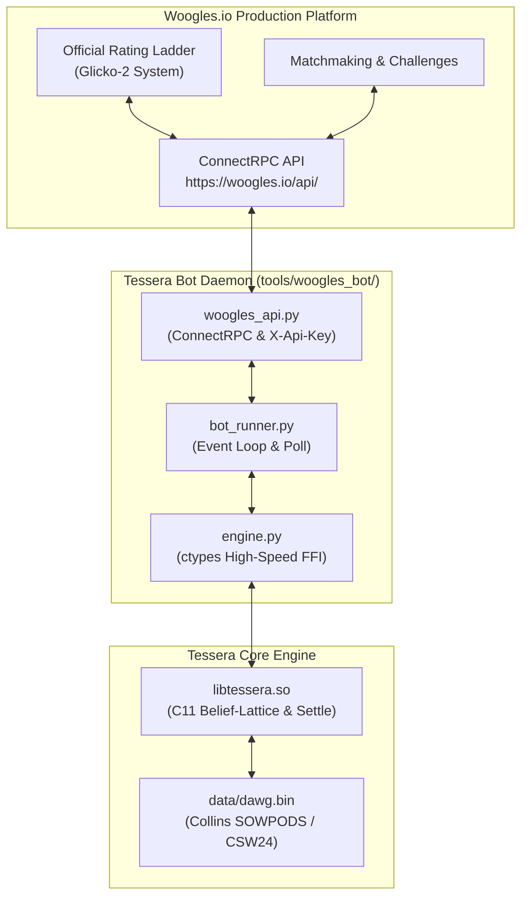

# Tessera Woogles.io Bot Integration

This directory contains the official bridge connecting the **Tessera Scrabble Engine** directly to **[Woogles.io](https://woogles.io)** (the official tournament platform partner of WESPA, NASPA, and CoCo) to acquire an audited, official server-certified **Glicko-2 Elo rating**.

---

## Architecture Overview



---

## 1. Prerequisites & Account Setup

1. **Create an Account on Woogles**:
   * Visit **[https://woogles.io](https://woogles.io)**.
   * Sign up for your bot account (e.g., `TesseraAI` or your desired bot handle).
2. **Generate Your Woogles API Key**:
   * Log into your account on Woogles.
   * Click on your profile icon in the upper right and select **Settings**.
   * Navigate to the **API Keys** section.
   * Click **Create Key** and copy your generated key (`wgl_...`).
3. **Build the Shared Library**:
   Ensure `libtessera.so` is compiled:
   ```bash
   make lib
   ```

---

## 2. Running the Bot

Run the bot runner directly from the project root:

```bash
python3 tools/woogles_bot/bot_runner.py \
    --username <YOUR_BOT_USERNAME> \
    --api-key <YOUR_WOOGLES_API_KEY> \
    --lexicon CSW24 \
    --delib 35
```

Alternatively, you can export your credentials as environment variables:

```bash
export WOOGLES_USERNAME="YourBotUsername"
export WOOGLES_API_KEY="wgl_your_api_key_here"

python3 tools/woogles_bot/bot_runner.py
```

### Command Line Options

| Flag | Default | Description |
|---|---|---|
| `--username`, `-u` | `$WOOGLES_USERNAME` | Your registered Woogles.io username |
| `--api-key`, `-k` | `$WOOGLES_API_KEY` | Your personal Woogles API Key |
| `--lexicon`, `-l` | `CSW24` | Tournament dictionary (`CSW24`, `CSW21`, `NWL20`, `NWL23`) |
| `--delib`, `-d` | `35` | Deliberation steps per turn (20 = fast, 45 = deep championship) |
| `--time-minutes`, `-t` | `25` | Official WESPA clock time per player (minutes) |
| `--unrated` | `False` | Play casual unrated games instead of rated ladder games |
| `--test` | `False` | Run local C11 engine self-test and exit |

---

## 3. Viewing Your Official Rating

Once your bot completes rated matches against human tournament players and rated bots (such as *HastyBot* or *BestBot*):
1. Navigate to: `https://woogles.io/@<YOUR_BOT_USERNAME>`
2. View your **certified Glicko-2 rating**, **Rating Deviation (RD)**, and full tournament match history.
